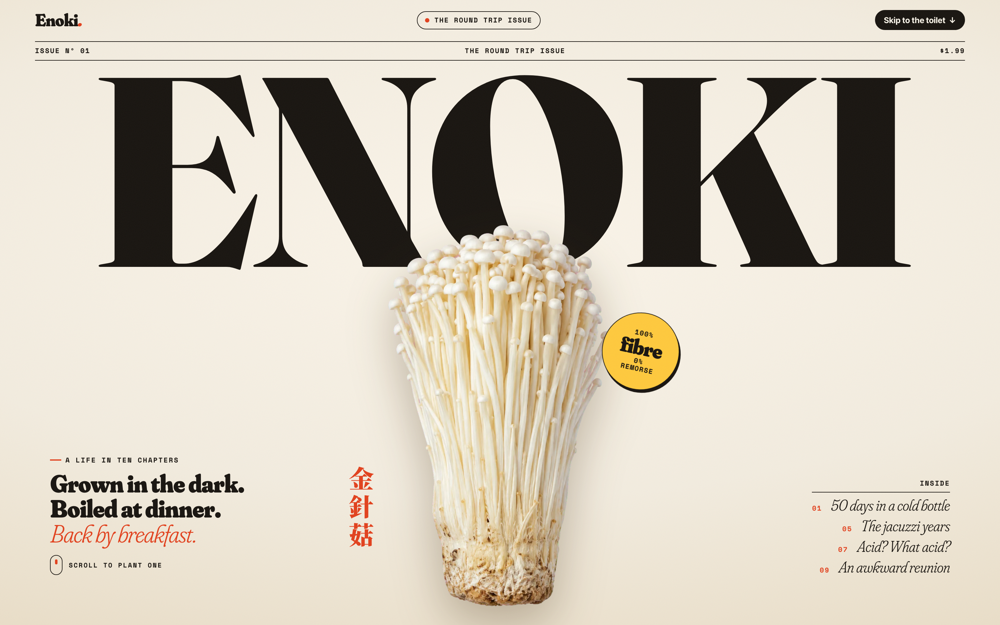
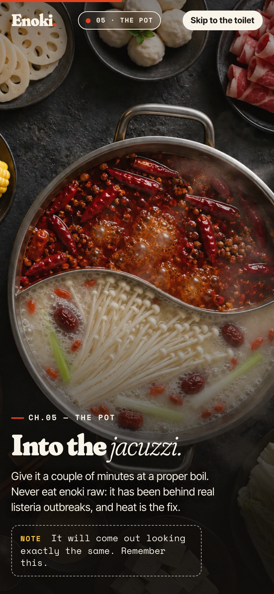

# ENOKI — The Round Trip Issue

A scroll-driven magazine feature about the full life of an enoki mushroom: bottle farm → fifty days of waiting → harvest → supermarket → hot pot → mouth → stomach → small intestine → toilet → *see you tomorrow* (明天見).

An unusually thorough mushroom biography. Most food websites stop at the recipe;
this one insists on attending the exit interview.

Live: https://enoki-tomorrow.vercel.app



Desktop magazine cover and the mobile Pot chapter, captured from the running website at 2× pixel density.



## Run locally

```sh
npm ci
npm run dev
```

Open the local URL Vite prints. The website needs no environment variables or API key;
the finished images are included. `npm run build` produces `dist/`, and
`npm run preview` serves that build locally. Optional image regeneration uses your own
authenticated Codex CLI; `gen.sh` currently assumes the original local checkout path.

## How it works

- **One sticky stage, one scrubbed GSAP timeline** (`src/main.js`). `T` maps each chapter to timeline units; one unit is 9% of a screen of scroll. The timeline is rebuilt from scratch when the layout width changes, so every measurement in it is a plain number.
- **Plates** are full-bleed 3:2 photos (2:3 on portrait screens) that always cover the stage. Landmarks such as the milky half of the pot or the toilet bowl are stored as `--tx/--ty` percentages on the plate, and travellers (the bunch, the cooked strands) fly to them.
- **Layouts**: stacked for phones and portrait tablets, side-by-side for landscape screens, plus a compact variant for short windows and phones on their side.
- `?capture` turns off scroll smoothing and free-running CSS animation, so each scroll position renders exactly one frame. The scripts below rely on it.

## Images

All photography and illustration was generated through the Codex CLI `imagegen` skill, one `codex exec` run per asset:

```sh
./gen.sh <name> prompts/<name>.txt [reference.png]   # → gen/<name>.png
node scripts/key.mjs gen/<name>.png                  # magenta backdrop → alpha (cut-outs only)
npm run images                                       # trim, resize, WebP → public/img
```

Prompts live in `prompts/`. Cut-outs are shot on a flat magenta backdrop and keyed with colour un-mixing in `scripts/key.mjs`.

The small intestine is a sketch-to-render edit: `ref/gut-guide.png` is the flat route the enoki rides (the same numbers as `G` in `src/main.js`), and `prompts/intestine.txt` asks for a photoreal intestine painted along it on white. It is multiplied onto the paper background, so it keeps its real contact shadow without keying.

## Checking every scroll position

```sh
npm run dev                                   # http://localhost:5199
node scripts/shoot.mjs                        # contact sheets, desktop + mobile  (ONLY=small,laptop,tablet,landscape,ipadland)
node scripts/audit.mjs 8                      # every 8px: text overlap, clipped text, sideways overflow, on 9 viewports
node scripts/record.mjs desktop 12            # frame every 12px → recordings/enoki-scroll-desktop.mp4
node scripts/frame.mjs desktop shots/f 135    # one full-resolution frame at timeline unit 135
URL=https://enoki-tomorrow.vercel.app/?capture node scripts/audit.mjs   # same checks against production
```

## Deploy

```sh
npx vercel --prod
```

## What this backup contains

The website source, shipped images and font, original generated PNGs, prompts,
reference sketch, image-processing and browser-check scripts, deployment configuration,
and dependency lockfile are included. Installed dependencies, build output, Vercel's
local project link, generation logs/previews, unselected QA captures and scroll recordings
stay local. The curated README screenshots in `docs/screenshots/` are included.
The scripts can regenerate the QA captures when needed.
