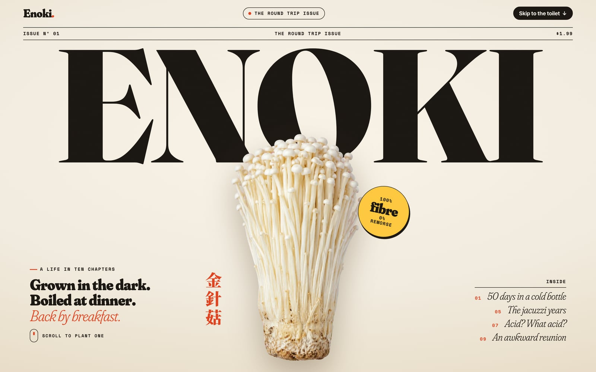
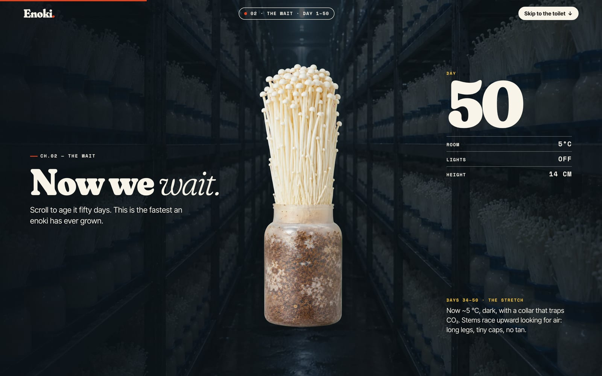
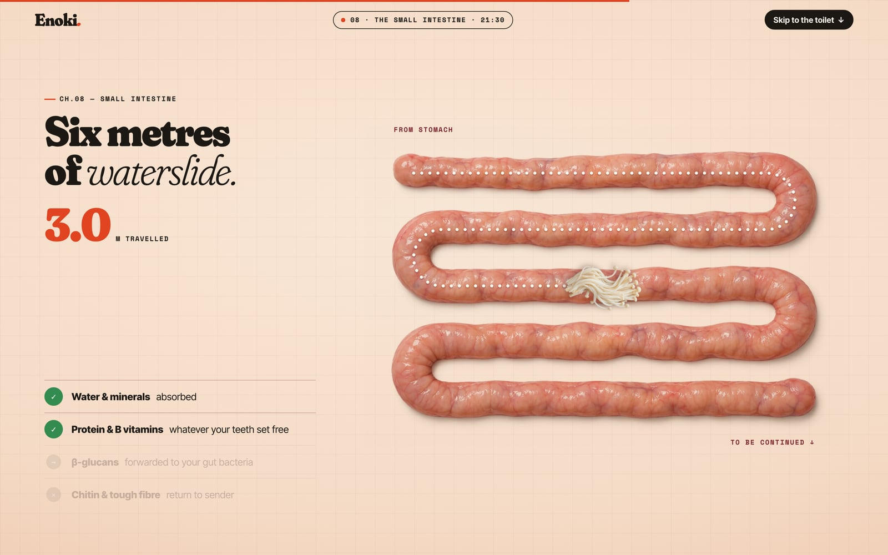
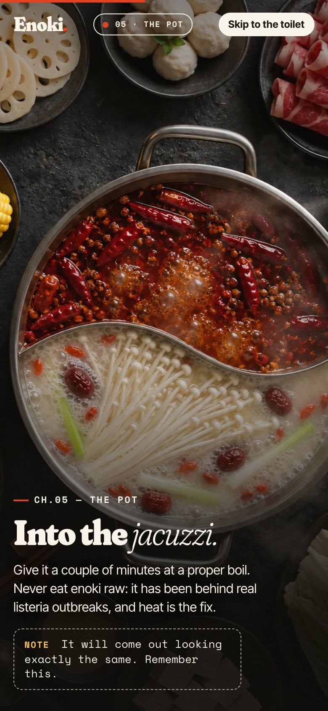
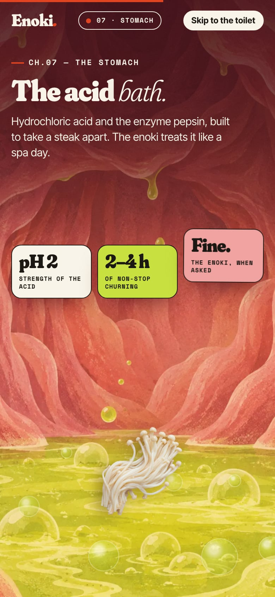
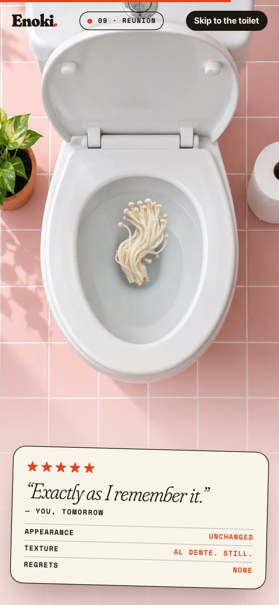

# ENOKI — The Round Trip Issue

> Grown in the dark. Boiled at dinner. Back by breakfast.
> The complete, slightly too honest life story of the enoki mushroom.

[](https://davidyen1124.github.io/enoki-tomorrow/)

**Read the issue: <https://davidyen1124.github.io/enoki-tomorrow/>**

## What is this?

A scroll-driven magazine feature about the full life of an enoki mushroom: bottle farm → fifty days of waiting → harvest → supermarket → hot pot → mouth → stomach → small intestine → toilet → *see you tomorrow* (明天見).

An unusually thorough mushroom biography. Most food websites stop at the recipe; this one insists on attending the exit interview.

In Taiwan and China, 金針菇 has a nickname: the "see you tomorrow" mushroom. It is not a figure of speech. You eat it at dinner, you barely chew it, and the next morning it is back, looking the way it did when it went in. This site follows one bunch the whole way round. There is a nutrition label, an odometer and a five-star review.

## The itinerary

Ten chapters. The times are the ones the navigation bar shows as you scroll on a desktop screen.

| Ch. | When | Where | What happens |
|---|---|---|---|
| 01 | Day 0 | The Farm | Born in a plastic bottle, in a refrigerated room, in the dark. |
| 02 | Day 1–50 | The Wait | You scroll, it grows. For the first 25 days there is nothing to see. The site's advice: "Keep scrolling. This is farming." |
| 03 | Day 50 | The Harvest | Pulled. Trimmed. Bagged. |
| 04 | Day 52 | The Store | Aisle 7, bottom shelf, $1.99. The price tag adds: "emotional cost: later". |
| 05 | 19:04 | The Pot | A haircut, then the jacuzzi. A note says it will come out looking exactly the same, and asks you to remember this. |
| 06 | 19:06 | The Mouth | Chews recommended: 30. Chews performed: 3. |
| 07 | 19:07 | The Stomach | Acid at pH 2, for two to four hours. The enoki, when asked: "Fine." |
| 08 | 21:30 | The Small Intestine | Six metres of waterslide. Water and minerals: absorbed. Chitin and tough fibre: return to sender. |
| 09 | 07:15 | The Reunion | Well, well, well. |
| 10 | Same time | Tomorrow | 明天見. There is a button to plant another one. |

The journey is about 26 screens of scrolling. If that is too long to wait, there is a **Skip to the toilet** button in the top right corner, and it stays there for the whole trip.

| Day 50 | 3.0 metres in |
|---|---|
|  |  |

Phones get their own layout and their own portrait photos.

| 19:04 | 19:07 | 07:15 |
|---|---|---|
|  |  |  |

Every picture in this README is a real screenshot of the site.

## FAQ

**Is this true?**
Yes, which is the upsetting part. Mushroom cell walls are built from chitin and β-glucans, the same family of stuff as crab shell, and you make only a little of the enzyme that cuts chitin. Add a long slippery stem and three chews, and your stomach has almost nothing to grab.

**Is it normal?**
The site's answer: "Completely. It's fibre." It adds that food usually takes one to three days to make the whole trip, and that if you would like a quieter reunion, you should chew more.

**Can I eat it raw?**
No. This is the part where the site stops joking. Raw enoki has caused real listeria outbreaks and recalls. Give it a couple of minutes at a proper boil.

**Do I really have to scroll through all fifty days?**
Yes. The site points out that this is still the fastest an enoki has ever grown.

**Who is the man in chapter 6?**
Nobody. He was generated for this story, along with the farm, the supermarket shelf, the hot pot, the stomach and the toilet. No real person was asked to swallow anything.

## What's inside

- **One sticky stage, one scrubbed [GSAP](https://gsap.com/) timeline** (`src/main.js`). `T` maps each chapter to timeline units. One unit is 9% of a screen of scroll, and the journey is 277 units long. The timeline is rebuilt from scratch when the layout width changes, so every measurement in it is a plain number.
- **Plates** are full-bleed 3:2 photos (2:3 on portrait screens) that always cover the stage. Landmarks such as the milky half of the pot or the toilet bowl are stored as `--tx/--ty` percentages on the plate, and travellers (the bunch, the cooked strands) fly to them. That is how the enoki finds the bowl on every screen size.
- **Layouts**: stacked for phones and portrait tablets, side-by-side for landscape screens, plus a compact variant for short windows and phones on their side.
- **The small intestine** is a sketch-to-render edit. `assets-src/ref/gut-guide.png` is the flat route the enoki rides (the same numbers as `G` in `src/main.js`), and `assets-src/prompts/intestine.txt` asks for a photoreal intestine painted along it on white. It is multiplied onto the paper background, so it keeps its real contact shadow without keying.
- **Images**: nothing here was photographed. All photography and illustration was generated through the Codex CLI `imagegen` skill, one `codex exec` run per asset. The prompts are in `assets-src/prompts/`.
- **Type**: Fraunces, Inter Tight and Space Mono, self-hosted through Fontsource. The Chinese is set in a 2.5 KB subset of Noto Serif TC that holds exactly eight characters. Six of them spell 金針菇 and 明天見. The other two are 榎茸, which the page does not use.
- **No backend.** The site is static files. It needs no environment variables or API key, and it loads nothing from anyone else's server.

## Run it locally

```sh
npm ci
npm run dev        # http://localhost:5199
npm run build      # static site in dist/
npm run preview    # serves dist/, also on 5199
```

The port is pinned in `vite.config.js`. If 5199 is taken, `npm run dev -- --port 4000` moves it.

`?capture` turns off scroll smoothing and free-running CSS animation, so each scroll position renders exactly one frame. The scripts below rely on it.

## Checking every scroll position

A page that is one long animation can break at any pixel, so the checks walk all of them. Start `npm run dev` first.

```sh
node scripts/shoot.mjs                        # contact sheets, desktop + mobile  (ONLY=small,laptop,tablet,landscape,ipadland)
node scripts/audit.mjs 8                      # every 8px: text overlap, clipped text, sideways overflow, on 8 viewports
node scripts/record.mjs desktop 12            # frame every 12px → recordings/enoki-scroll-desktop.mp4 (needs ffmpeg)
node scripts/frame.mjs desktop shots/f 135    # one full-resolution frame at timeline unit 135
node scripts/live.mjs                         # without ?capture: intro, skip button, resize, restart button
URL=https://davidyen1124.github.io/enoki-tomorrow/?capture node scripts/audit.mjs   # same checks against the live site
```

Captures go to `shots/` and `recordings/`, which are git-ignored.

## Remaking the images

You do not need to. The finished images are in `public/img/`. If you want to anyway, `scripts/gen.sh` uses your own authenticated Codex CLI:

```sh
scripts/gen.sh <name> assets-src/prompts/<name>.txt [reference.png]   # → assets-src/gen/<name>.png
node scripts/key.mjs assets-src/gen/<name>.png                        # magenta backdrop → alpha (cut-outs only)
npm run images                                                        # trim, resize, WebP → public/img
```

Cut-outs are shot on a flat magenta backdrop and keyed with colour un-mixing in `scripts/key.mjs`.

## Where things live

| Path | What it is |
|---|---|
| `index.html`, `src/` | The site: one page, one stylesheet, one timeline. |
| `public/` | Files served as-is: the WebP images, the social card, the favicon, and the eight-character font. |
| `assets-src/gen/` | The generated PNGs at full size, before keying, trimming and compression. |
| `assets-src/prompts/` | The prompt behind every image. |
| `assets-src/ref/` | `gut-guide.png`, the route sketch for the small intestine. |
| `scripts/` | The image pipeline (`gen.sh`, `key.mjs`, `optimize-images.mjs`) and the browser checks. |
| `docs/screenshots/` | The pictures in this README. |

Nothing in `assets-src/` is shipped. The build only reads `index.html`, `src/` and `public/`.

## Deploying

Pushing to `main` runs [a GitHub Actions workflow](.github/workflows/pages.yml) that builds with Vite and publishes `dist/` to GitHub Pages. The build uses relative paths (`base: './'`), so it works under `/enoki-tomorrow/` or anywhere else.

## Disclaimer

Friendly science, not medical advice. Photographs and illustrations were generated for this story. No mushrooms were digested in the making of this website.
